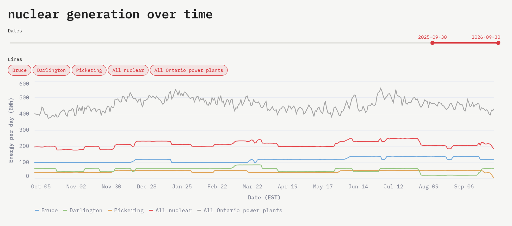
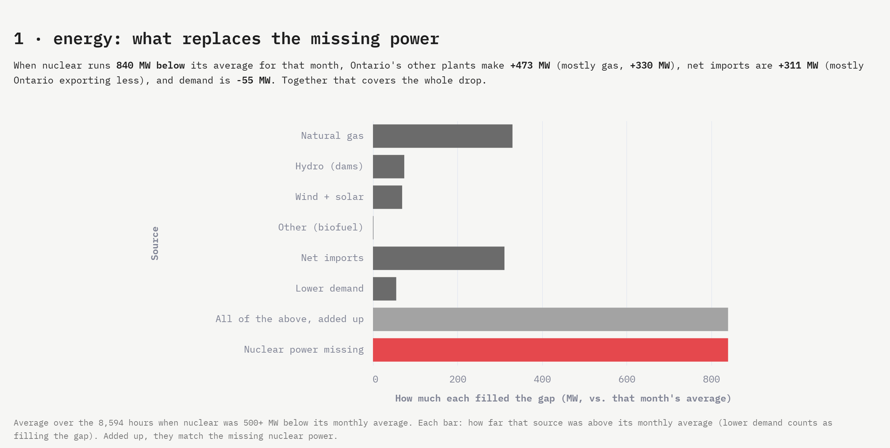

# What happens to Ontario's grid when a nuclear reactor goes offline?

I've spent 10+ months as an intern at Eclipse Automation, helping build tooling for the Pickering Nuclear Reactor refurbishment, one of the largest infrastructure projects in Canada. That got me curious about how my work affects the way electricity is supplied across Ontario. So I did what any rational person would do: I learned SQL and data analytics to find out.

This project takes every hour of Ontario's public electricity data since May 2019, finds every time one of the province's 18 nuclear reactors went offline, and works out what happened next: which other power sources filled the gap, whether electricity got more expensive, how much extra pollution it caused, and what the reactors themselves were doing.

**See the findings on the live dashboard: [nuclear-dashboard.streamlit.app](https://nuclear-dashboard.streamlit.app/)** (if it's been idle, it takes a moment to wake up)




I found a cool website called [GitDiagram](https://gitdiagram.com/danielzhang122/ontario-nuclear-dashboard) that visualizes this repo and makes a one-minute video tour of how it works:

[](https://gitdiagram.com/danielzhang122/ontario-nuclear-dashboard/video)

## What it looks at

1. **When do reactors go offline?** Every outage of a day or longer, for every reactor.
2. **What fills the gap?** When a reactor stops, something else has to make that power: gas plants, dams, wind and solar, power bought from neighbouring provinces and states, or people simply using less.
3. **Does electricity get more expensive?** The wholesale price when reactors are down vs. when they're running.
4. **How much extra pollution?** Gas plants fill in a lot of the gap, and they release CO2.
5. **What were the reactors themselves doing?** How often they go down, how long outages last, how they run between outages, and how closely what they made matches what they said they could make.

## What makes it different

[Gridwatch](https://live.gridwatch.ca/) shows what Ontario's grid is producing right now. This project looks back over years instead:

- **Years of history, not a live snapshot:** hourly data from May 2019 to September 2026
- **Finds the outages itself** from the raw data, instead of relying on announcements
- **Conclusions, not just charts:** things you can state, like "Darlington 4's refurbishment was linked with about 64,000 extra tonnes of CO2 in its first two weeks, as gas covered the lost output"
- **Explains itself:** every chart and number on the dashboard is written for someone who's never heard of a megawatt, with tabs for how the grid works (Core concepts), what each word means (Key terms) and where every fact comes from (References)
- **Honest about limits:** it says what hourly data can't tell you, and keeps "likely" separate from "confirmed"

## Progress

- [x] **Goal 1:** find every outage (206 outages of a day or longer)
- [x] **Goal 2:** what filled the gap, overall and for each outage
- [x] **Goal 3:** the effect on prices
- [x] **Goal 3.5:** why outages raise prices so little (about \$4/MWh for every 1,000 MW of nuclear missing). Tested one explanation at a time: other sources fill the gap (gas and fewer exports cover about three quarters), outages are timed for the low-demand months, the effect is a little bigger when demand is high, and bigger outages don't hurt disproportionately. Still open: the cost paid outside the hourly price (the Global Adjustment), which needs data this project doesn't have yet
- [x] **Goal 4:** the extra CO2
- [x] **Goal 5:** what the reactors themselves were doing, in six parts:
  1. every hour of every reactor labelled "running normally", "off", "partly running" or "could run but made less"
  2. restarts and maneuvers: half of restarts are back at steady full power within 33 hours, about 1 in 5 goes offline again first, and Bruce turns down in fixed steps of about 300 MW when Ontario has more power than it needs
  3. planned or unexpected: a careful guess from how each outage began, checked against a small answer key from public records. About half of outages stay "can't tell", on purpose
  4. going down together: reactors at the same plant are off together about as often as coincidence predicts, but a few times a whole plant shut down at once
  5. prediction: there are real warning signs, but a model built on them does no better than a coin flip on years it hasn't seen. Public hourly data isn't enough to predict outages
  6. what *can* be forecast: one hour into an outage, a model tells long outages from short ones on years it has never seen (74%, where 50% is a coin flip), and a simple rule shows the price is higher the day after a surprise outage (72% of the time, by about \$15/MWh). Forecasting when a restart will finish didn't work
- [x] **Goal 6:** the [dashboard](https://nuclear-dashboard.streamlit.app/)
- [ ] **Goal 7 (maybe):** update the data automatically every day

Still to come: lesson-plan guides for milestones 2 to 5 (milestone 1 has one), tests for the newer queries, the Global Adjustment question, and a longer answer key of planned and forced outages.

## How it's built

```
IESO public data  →  Python (download and clean)  →  DuckDB database  →  SQL queries  →  Streamlit dashboard
```

- **Data:** hourly output and capability for every generator of 20 MW or more, plus Ontario's imports/exports and wholesale prices, all from the IESO (Ontario's grid operator)
- **SQL ([queries/](queries/)):** I'm learning SQL as I go, so the files run from simple `SELECT`s (01) up to window functions (15, 16), a survival curve written in plain SQL (23) and line fits (32). Each file explains its steps at the top
- **Dashboard ([app.py](app.py)):** runs the SQL files directly, so the page always matches the queries
- **Statistics ([scripts/stats.py](scripts/stats.py)):** the parts SQL can't do (error bars, shuffle tests, a prediction model, a regression with controls), written with numpy only so the method can be read
- **More detail:** [a plain-language guide to the milestone 1 queries](docs/milestone1_queries.md), and a report with every number and check for each part: Goal 5 milestones [1](reports/goal5_milestone1.md), [2](reports/goal5_milestone2.md), [3](reports/goal5_milestone3.md), [4](reports/goal5_milestone4.md), [5](reports/goal5_milestone5.md), [the forecasting models](reports/quant_models.md) and [Goal 3.5](reports/goal3_5_prices.md)

## Run it

Works on Linux, macOS and Windows (Python 3.13).

To run just the dashboard (the cleaned data is already in the repo, and the app builds its database on first start):

```
python3 -m venv .venv
source .venv/bin/activate      # Windows: .venv\Scripts\activate
pip install -r requirements.txt
streamlit run app.py           # opens at http://localhost:8501
```

To rebuild everything from scratch:

```
python scripts/ingest.py       # download + clean the IESO data again (for newer data)
python scripts/build_db.py     # build data/nuclear.duckdb
python tests/test_events.py    # small made-up test cases for the outage and reactor-label queries
python scripts/goal5_report.py # regenerate the Goal 5 milestone 1 report
python scripts/research_report.py # regenerate the milestone 2-5 and Goal 3.5 reports
python scripts/quant_models.py   # the walk-forward forecasting models (run after research_report.py)
duckdb -readonly data/nuclear.duckdb   # explore the database yourself
```

The DuckDB command-line tool is a separate install ([duckdb.org/docs/installation](https://duckdb.org/docs/installation/), or `brew install duckdb` on macOS, `winget install DuckDB.cli` on Windows). It must be the same version as, or newer than, the `duckdb` package in requirements.txt.

The database itself isn't in git (it's over GitHub's 100 MB limit); the cleaned data in `data/clean/` is, and `build_db.py` (or the app) builds the database from it in about 20 seconds.

## Tables

| Table | Rows | What's in it |
|---|---|---|
| `generators` | 193 | each generator, its fuel type and plant |
| `generation` | 11.8M | output and capability for every generator, every hour |
| `refurbishments` | 13 | announced refurbishments and shutdowns, with sources ([reference/](reference/refurbishments.csv)) |
| `interties` | 68.6k | Ontario's total imports, exports and net flow every hour |
| `prices` | 57.7k | wholesale price every hour ($/MWh): the old market (HOEP, until Apr 2025) and the new one (from Jul 31, 2026) |
| `assumptions` | 1 | every number that's assumed rather than measured, with its source (the CO2 per MWh of gas power) |
| `outages` | 206 | every outage of a day or longer, built by [06_outages.sql](queries/06_outages.sql) |
| `unit_hours` | 1.16M | every reactor-hour with its full power at the time and its label, built by [15_unit_states.sql](queries/15_unit_states.sql) |
| `unit_events` | 3.1k | stretches of hours in a row with the same label, built by [16_unit_events.sql](queries/16_unit_events.sql) |
| `restarts` | 198 | every restart after an outage, with how long it took to get back, built by [22_restarts.sql](queries/22_restarts.sql) |
| `maneuvers` | 357 | every time reactors turned down and came back without an outage, built by [25_maneuvers.sql](queries/25_maneuvers.sql) |
| `outage_labels` | 12 | outages a public source calls planned or forced, with sources ([reference/](reference/outage_labels.csv)) |
| `outage_features` | 200 | how each outage began, built by [27_shutdown_features.sql](queries/27_shutdown_features.sql) |
| `outage_kinds` | 200 | the planned / unplanned / can't-tell guess for each outage, built by [28_outage_kinds.sql](queries/28_outage_kinds.sql) |
| `unit_days` | 35.5k | every day a reactor was running, with warning signs and what happened next, built by [30_unit_days.sql](queries/30_unit_days.sql) |

## Data

- [IESO Generator Output and Capability](https://reports-public.ieso.ca/public/GenOutputCapabilityMonth/): generators of 20 MW or more; small local generators like rooftop solar aren't included
- [IESO Intertie Schedule and Flow](https://reports-public.ieso.ca/public/IntertieScheduleFlowYear/): hourly imports and exports, 2019 →
- Prices: [HOEP](https://reports-public.ieso.ca/public/PriceHOEPPredispOR/) (old market, to Apr 2025) and [day-ahead Ontario Zonal Price](https://reports-public.ieso.ca/public/DAHourlyOntarioZonalPrice/) (new market). The IESO only keeps about 90 days of the new price online, so there's no public data for May 2025 to Jul 2026
- Refurbishment dates: OPG, Bruce Power and news sources, linked per row
- Planned and forced outages: CNSC status reports and Bruce Power releases, linked per row

## License

[MIT](LICENSE) for the code and SQL. The data is IESO's, published under their [terms of use](https://www.ieso.ca/terms-of-use).
