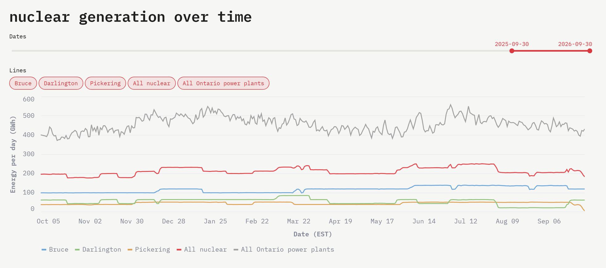
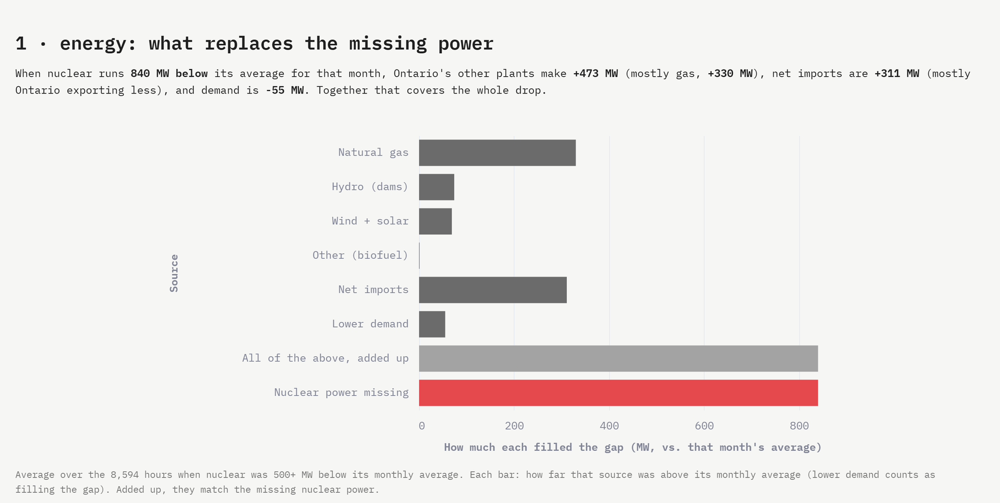

# What happens to Ontario's grid when a nuclear reactor goes offline?

I've spent 10+ months as an intern at Eclipse Automation, helping build tooling for the Pickering Nuclear Reactor refurbishment, one of the largest infrastructure projects in Canada. That got me curious about how my work affects the way electricity is supplied across Ontario. So I did what any rational person would do: I learned SQL and data analytics to find out.

This project takes every hour of Ontario's public electricity data since May 2019, finds every time one of the province's 18 nuclear reactors went offline, and works out what happened next: which other power sources filled the gap, whether electricity got more expensive, how much extra pollution it caused, and what the reactors themselves were doing.

**See the findings on the live dashboard: [nuclear-dashboard.streamlit.app](https://nuclear-dashboard.streamlit.app/)** (if it's been idle, it takes a moment to wake up)




## What it looks at

1. **When do reactors go offline?** Every outage of a day or longer, for every reactor.
2. **What fills the gap?** When a reactor stops, something else has to make that power: gas plants, dams, wind and solar, power bought from neighbouring provinces and states, or people simply using less.
3. **Does electricity get more expensive?** The wholesale price when reactors are down vs. when they're running.
4. **How much extra pollution?** Gas plants fill in a lot of the gap, and they release CO2.
5. **What were the reactors themselves doing?** How often they go down, how long outages last, how they run between outages, and how closely what they made matches what they said they could make.

## What makes it different

[Gridwatch](https://live.gridwatch.ca/) shows what Ontario's grid is producing right now. This project looks back over years instead:

- **Years of history, not a live snapshot:** hourly data from May 2019 to September 2026
- **Finds the outages itself** from the raw data, instead of relying on announcements
- **Conclusions, not just charts:** things you can state, like "Darlington 4's refurbishment added about 64,000 tonnes of CO2 in its first two weeks"
- **Explains itself:** every chart and number on the dashboard is written for someone who's never heard of a megawatt, with tabs for how the grid works (Core concepts), what each word means (Key terms) and where every fact comes from (References)
- **Honest about limits:** it says what hourly data can't tell you, and keeps "likely" separate from "confirmed"

## Progress

- [x] **Goal 1:** find every outage (206 outages of a day or longer)
- [x] **Goal 2:** what filled the gap, overall and for each outage
- [x] **Goal 3:** the effect on prices
- [ ] **Goal 3.5 (backlog):** why outages raise prices so little (about \$4/MWh). Explanations to test: the price is set by the last plant needed, not by nuclear's own cost; other sources fill the gap; when outages happen and how high demand is; Ontario exporting less; most of the cost being paid outside the hourly price (the Global Adjustment); and whether bigger outages raise prices disproportionately
- [x] **Goal 4:** the extra CO2
- [ ] **Goal 5:** what the reactors themselves were doing. Milestone 1 is done: every hour of every reactor is labelled "running normally", "off", "partly running" or "could run but made less", which shows how often reactors go down, how long outages last and how they run in between
- [x] **Goal 6:** the [dashboard](https://nuclear-dashboard.streamlit.app/)
- [ ] **Goal 7 (maybe):** update the data automatically every day

Coming next in Goal 5: how quickly reactors get back to full power after an outage, telling planned shutdowns apart from unexpected ones (using public records from OPG, Bruce Power and the IESO), whether several reactors at the same plant tend to go down together, and whether outages can be predicted before they happen (for example from warning signs like a reactor running at reduced power in the days before).

## How it's built

```
IESO public data  →  Python (download and clean)  →  DuckDB database  →  SQL queries  →  Streamlit dashboard
```

- **Data:** hourly output and capability for every generator of 20 MW or more, plus Ontario's imports/exports and wholesale prices, all from the IESO (Ontario's grid operator)
- **SQL ([queries/](queries/)):** I'm learning SQL as I go, so the files run from simple `SELECT`s (01) up to window functions (15, 16). Each file explains its steps at the top
- **Dashboard ([app.py](app.py)):** runs the SQL files directly, so the page always matches the queries
- **More detail:** [a plain-language guide to the Goal 5 queries](docs/milestone1_queries.md) and [the full Goal 5 report with every number and check](reports/goal5_milestone1.md)

## Run it

Works on Linux, macOS and Windows (Python 3.13).

To run just the dashboard (the cleaned data is already in the repo, and the app builds its database on first start):

```
python3 -m venv .venv
source .venv/bin/activate      # Windows: .venv\Scripts\activate
pip install -r requirements.txt
streamlit run app.py           # opens at http://localhost:8501
```

To rebuild everything from scratch:

```
python scripts/ingest.py       # download + clean the IESO data again (for newer data)
python scripts/build_db.py     # build data/nuclear.duckdb
python tests/test_events.py    # small made-up test cases for the outage and reactor-label queries
python scripts/goal5_report.py # regenerate the Goal 5 report
duckdb -readonly data/nuclear.duckdb   # explore the database yourself
```

The DuckDB command-line tool is a separate install ([duckdb.org/docs/installation](https://duckdb.org/docs/installation/), or `brew install duckdb` on macOS, `winget install DuckDB.cli` on Windows). It must be the same version as, or newer than, the `duckdb` package in requirements.txt.

The database itself isn't in git (it's over GitHub's 100 MB limit); the cleaned data in `data/clean/` is, and `build_db.py` (or the app) builds the database from it in about 15 seconds.

## Tables

| Table | Rows | What's in it |
|---|---|---|
| `generators` | 193 | each generator, its fuel type and plant |
| `generation` | 11.8M | output and capability for every generator, every hour |
| `refurbishments` | 13 | announced refurbishments and shutdowns, with sources ([reference/](reference/refurbishments.csv)) |
| `interties` | 68.6k | Ontario's total imports, exports and net flow every hour |
| `prices` | 57.7k | wholesale price every hour ($/MWh): the old market (HOEP, until Apr 2025) and the new one (from Jul 31, 2026) |
| `assumptions` | 1 | every number that's assumed rather than measured, with its source (the CO2 per MWh of gas power) |
| `outages` | 206 | every outage of a day or longer, built by [06_outages.sql](queries/06_outages.sql) |
| `unit_hours` | 1.16M | every reactor-hour with its full power at the time and its label, built by [15_unit_states.sql](queries/15_unit_states.sql) |
| `unit_events` | 3.1k | stretches of hours in a row with the same label, built by [16_unit_events.sql](queries/16_unit_events.sql) |

## Data

- [IESO Generator Output and Capability](https://reports-public.ieso.ca/public/GenOutputCapabilityMonth/): generators of 20 MW or more; small local generators like rooftop solar aren't included
- [IESO Intertie Schedule and Flow](https://reports-public.ieso.ca/public/IntertieScheduleFlowYear/): hourly imports and exports, 2019 →
- Prices: [HOEP](https://reports-public.ieso.ca/public/PriceHOEPPredispOR/) (old market, to Apr 2025) and [day-ahead Ontario Zonal Price](https://reports-public.ieso.ca/public/DAHourlyOntarioZonalPrice/) (new market). The IESO only keeps about 90 days of the new price online, so there's no public data for May 2025 to Jul 2026
- Refurbishment dates: OPG, Bruce Power and news sources, linked per row

## License

[MIT](LICENSE) for the code and SQL. The data is IESO's, published under their [terms of use](https://www.ieso.ca/terms-of-use).
